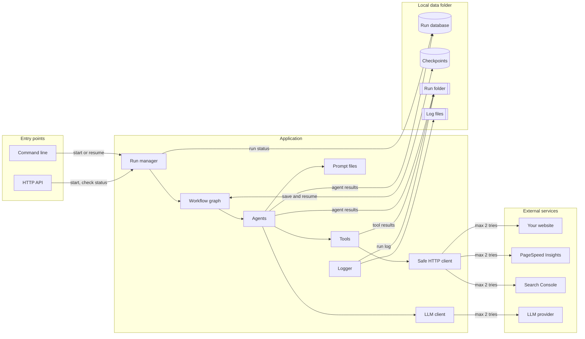
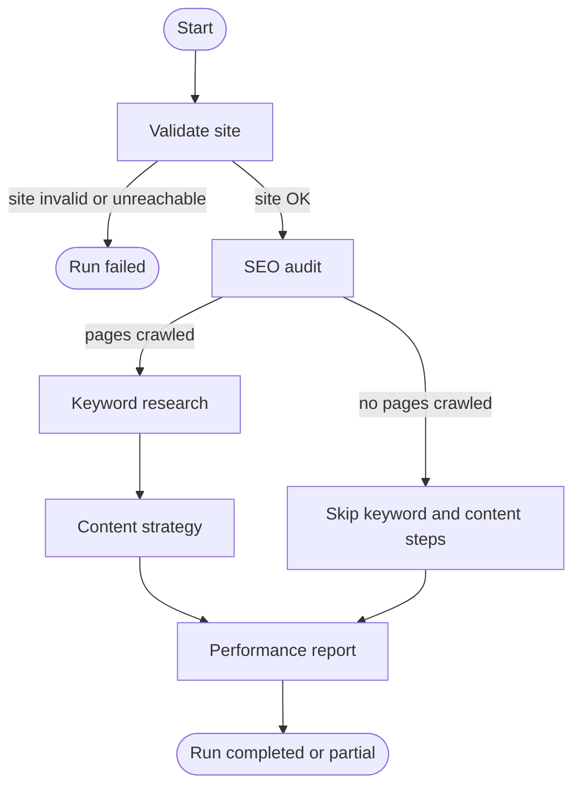
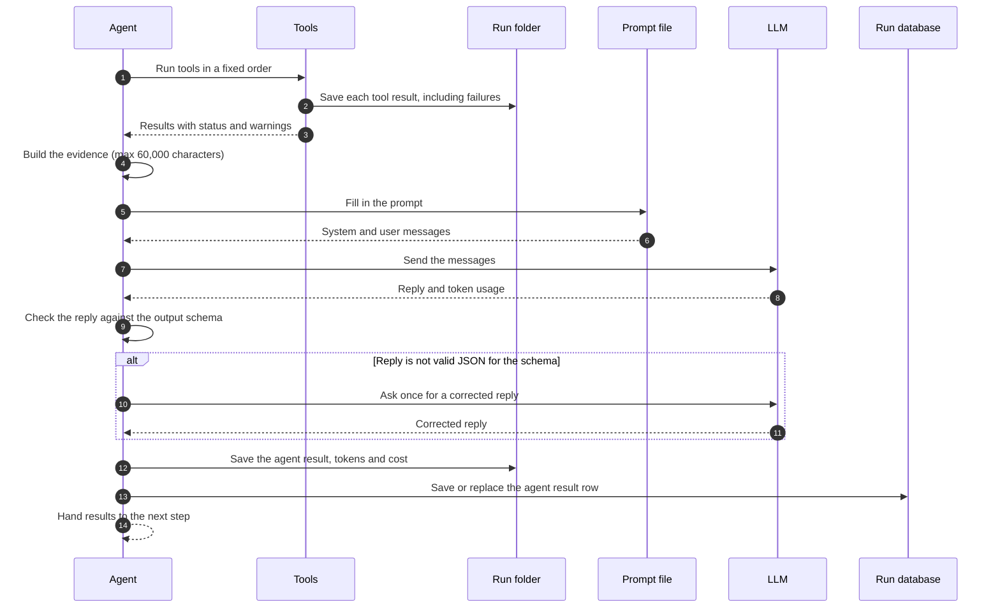
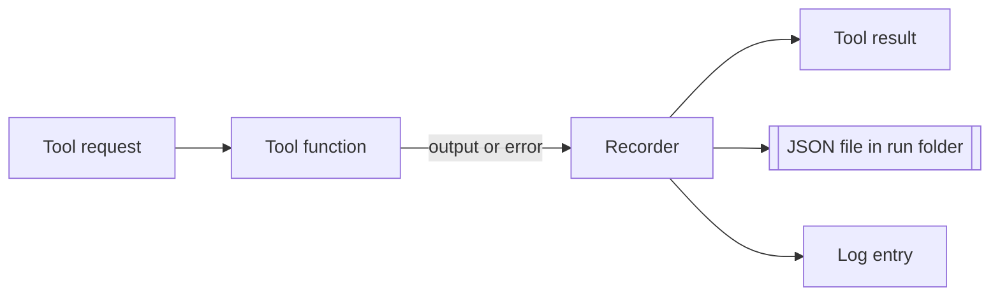
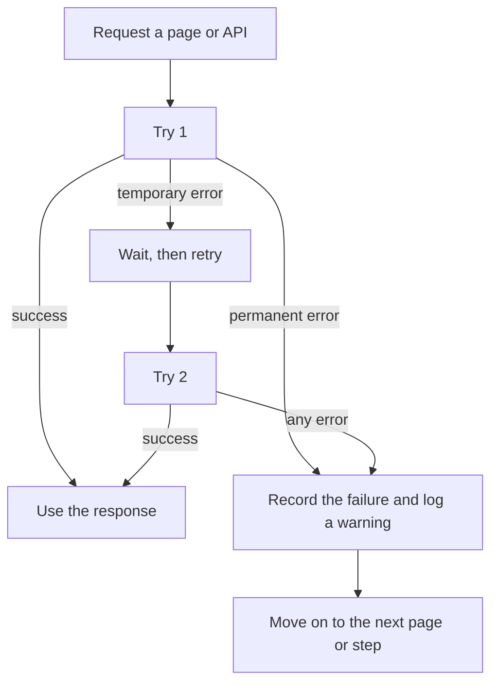
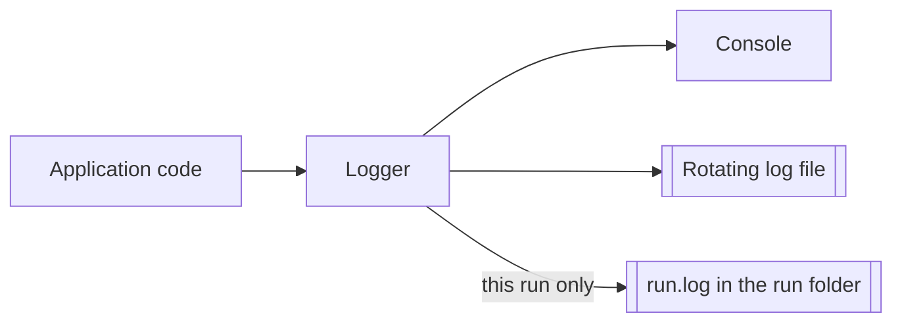
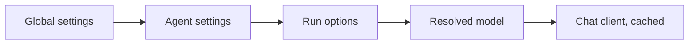
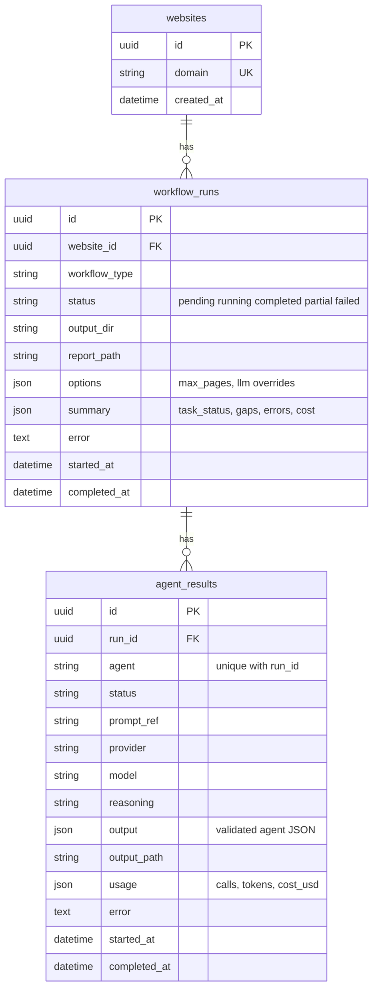
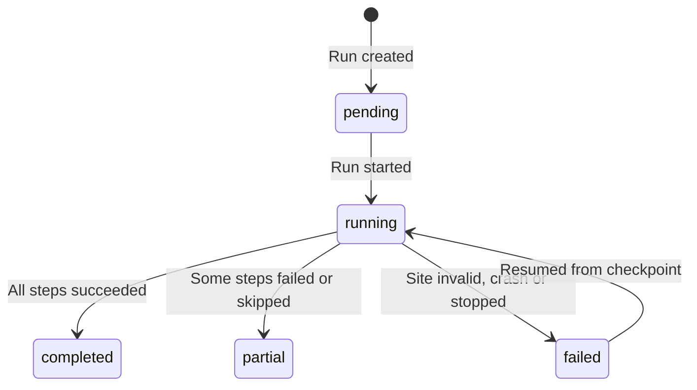

# SEO Agent — Architecture

How the system is built and exactly what happens during a run. Diagrams are Mermaid
(rendered by GitHub/GitLab and PyCharm's Markdown preview). Diagram labels use plain
names; the table under each diagram maps them to the code. Keep this file in sync with the
code: when behaviour changes, update the matching section.

**In one sentence:** a LangGraph workflow runs four agents in sequence; each agent first
runs deterministic tools (crawler, rule checks, Google APIs), every tool call is saved to
a time-stamped run folder, then an LLM analyses that evidence with a versioned YAML prompt
and returns schema-validated JSON; the last agent turns everything into `report.md`, an
action plan and CSV exports. Everything runs locally: SQLite files, no servers.

---

## 1. System overview



| Diagram label | Code | Responsibility |
|---|---|---|
| Command line | `src/runner.py` (`seo-agent`) | Parse options, check sources, start or resume a run, print the result |
| HTTP API | `src/main.py`, `src/api/` | `POST /runs`, `GET /runs/{id}`, health checks |
| Run manager | `src/orchestration/workflow.py` | Create the run record and folder, execute the graph, set the final status |
| Workflow graph | `src/orchestration/graph.py`, `state.py` | Step order, routing, checkpointing |
| Agents | `src/agents/` | Per agent: run tools, build evidence, call the LLM, validate, save |
| Tools | `src/tools/` | Deterministic work and external calls; every call recorded |
| Safe HTTP client | `src/tools/http.py` | All outbound requests: scope and IP checks, limits, retry policy |
| LLM client | `src/llm/` | Provider, model and reasoning resolution, client cache, prices |
| Prompt files | `src/prompts/*.yaml` | Versioned XML-tagged prompts per agent, shared snippets |
| Logger | `src/observability/logging.py` | Structured logs to console, rotating file and per-run log |
| Run database | `data/seo_agent.db` | Websites, runs, agent results (SQLite; Postgres optional) |
| Checkpoints | `data/checkpoints.db` | Workflow state after each step, for resume |
| Run folder | `data/output/<site>/<date>/run_<id>/` | Tool and agent JSON, manifest, report, CSVs, `run.log` |
| Log files | `data/logs/seo_agent.log` | All runs and API activity, JSON lines, rotated |

---

## 2. The workflow graph



| Diagram label | Graph node | Code |
|---|---|---|
| Validate site | `validate_site` | `orchestration/graph.py` → tool `validate_domain` |
| SEO audit | `seo_audit` | `agents/seo_audit.py` |
| Keyword research | `keyword_research` | `agents/keyword_research.py` |
| Content strategy | `content_strategy` | `agents/content_strategy.py` |
| Skip keyword and content steps | `skip_downstream` | `orchestration/graph.py` |
| Performance report | `performance_reporting` | `agents/performance_reporting.py` |

- **Sequential by design:** each agent uses the previous agents' outputs (crawl → topics →
  page matches → report).
- **Failure isolation:** every node is wrapped by `guarded_node`; an unexpected exception
  marks that step `failed`, records the error, and the run continues where dependencies
  allow. The reporting agent always runs once the audit has run.
- **Checkpoints:** after every node LangGraph saves the state to `data/checkpoints.db`
  (thread id = run id). `seo-agent --resume <run_id>` continues from the last completed
  node; if no checkpoint exists the run starts fresh.
- **Final run status** (`workflow_runs.status`): `failed` if `validate_site` failed,
  `completed` if every step succeeded, otherwise `partial`.

### Workflow state (`orchestration/state.py`)

Small and JSON-serializable; large data lives in files and is referenced by path.

| Key | Set by | Content |
|---|---|---|
| `run_id`, `website_id`, `site`, `run_date`, `output_dir`, `options` | `prepare_run` | Identity and options (`max_pages`, LLM overrides) |
| `start_url`, `allowed_hosts` | validate_site | Where the crawl starts; hosts it may visit (`site`, `www.site`) |
| `pages_crawled`, `coverage` | seo_audit | HTML pages analysed; sitemap size vs pages fetched |
| `artifacts` *(merged)* | every step | Name → JSON file in the run folder (`crawl`, `technical_seo`, `seo_audit`, …) |
| `task_status` *(merged)* | every step | Step → `succeeded` / `failed` / `skipped` |
| `sources` *(merged)* | audit, keywords | Data-source status lines for the report (PageSpeed, Search Console) |
| `data_gaps`, `errors` *(appended)* | every step | What was unavailable / what failed |
| `report_path`, `cost` | performance_reporting | Path of `report.md`; token totals and estimated USD |

---

## 3. Anatomy of one agent step

Every agent node follows the same sequence (`agents/base.py`):



- **At most 2 replies per agent:** one reply plus one correction. Token usage of both is
  counted. (Separately, each LLM call itself gets at most 2 tries on network or provider
  errors; see [Retry policy](#6-retry-policy).)
- **Code:** `agents/base.py` (`run_agent`, `_invoke_validated`); the correction text is
  the `output_correction` snippet in `prompts/shared.yaml`.
- **Validation:** replies may contain code fences or stray prose; the first JSON object is
  parsed and validated. Enum fields are case-insensitive.
- **If the LLM step fails**, the agent is recorded as `failed` with the error. Tool
  outputs are kept, and the report still renders from whatever exists.

---

## 4. What each step does exactly

### validate_site (`orchestration/graph.py` → `tools/domain.py`)

1. Resolve the domain; **every** IP must be public (no private, loopback, link-local,
   metadata or IPv4-mapped addresses).
2. Fetch `https://<site>/`, falling back to `http://`, and follow redirects (each hop
   re-validated).
3. Output: final URL, redirect chain, status code, addresses. `start_url` = final URL if
   it stays on `site`/`www.site`; `allowed_hosts` = those two hosts.

### Agent 1 — SEO audit (`agents/seo_audit.py`, prompt `seo_audit@v3`)

| # | Tool | What it does |
|---|---|---|
| 1 | `discover_site_urls` | Reads robots.txt and its `Sitemap:` lines (or `/sitemap.xml`), sitemap indexes and `.gz` sitemaps (XXE-safe), up to 50,000 URLs / 50 sitemaps. Counts URLs per template. **If it fails, the audit stops** (robots rules unknown). |
| 2 | `crawl_website` | Starts at `start_url` (depth 0) plus a **template-stratified sample** of sitemap URLs (round-robin across templates like `/jobs/*/*`, `/concepts/*/*`), then follows internal links up to `CRAWLER_MAX_DEPTH`. Respects robots.txt, page budget (`--max-pages` / `CRAWLER_MAX_PAGES`), `CRAWLER_CONCURRENCY` and `CRAWLER_DELAY_SECONDS`. Extracts title, meta description, robots, canonical, lang, H1/H2, word count, JSON-LD/microdata types, links, images, response time. |
| 3 | `analyze_technical_seo` | 33 deterministic rules (`tech-rules-v2`), each finding with **every affected URL and its measured value**. Also returns per-template health and which search/AI crawlers robots.txt allows. |
| 4 | `analyze_page_speed` × `PAGESPEED_MAX_URLS` | Homepage + most internally-linked pages; PageSpeed Insights (mobile): Lighthouse lab metrics + CrUX real-user p75 (URL or origin), top savings. |
| 5 | LLM | Reviews findings, adds expected-schema checks per page type (e.g. `JobPosting`), assigns severity, owner, effort and a verifiable `done_when`; compares with the previous run's audit. |

Rule families: homepage redirect to inner page / redirect chain; robots blocks site,
robots.txt missing, no `Sitemap:` line, sitemap missing, search crawlers blocked; HTTPS;
HTTP errors, fetch failures, redirect chains; broken internal links, links to redirects;
noindex, canonical elsewhere/missing, blocked by robots; title missing/long/short/duplicate;
description missing/long/duplicate; H1 missing/multiple; thin content; structured data
missing/invalid; images without alt; missing `lang`; slow server response (>1,500 ms,
crawler-observed); truncated pages.

### Agent 2 — Keyword research (`agents/keyword_research.py`, prompt `keyword_research@v3`)

| # | Tool | What it does |
|---|---|---|
| 1 | `get_search_performance` | **Skipped** without `GSC_SERVICE_ACCOUNT_FILE`. Otherwise authenticates the service account (read-only scope), picks the property (`GSC_PROPERTY`, else `sc-domain:<site>`, then URL-prefix variants) and fetches up to 5,000 query × page rows for the last `GSC_LOOKBACK_DAYS` (ending 3 days ago, as recent data is incomplete) **and** the previous window of equal length. |
| 2 | `score_keyword_opportunities` | `kw-score-v1` per query: `100 × (0.40·impressions_norm + 0.35·ctr_gap + 0.25·position_opportunity)` where impressions are log-normalised, CTR gap is measured against a position benchmark, and positions 4–20 get the most headroom. Adds confidence (by impressions), a suggested category, **quick wins** (positions 4–15, ≥ 20 impressions), **cannibalization** (≥ 2 pages each with ≥ 15 % of a query's ≥ 50 impressions), **top pages** and **declining pages** (≥ 30 % impression drop from ≥ 100). Skipped without Search Console data. |
| 3 | `extract_site_topics` | 1–3-word phrases recurring across titles/H1/H2 (brand words and stopwords removed), ranked by number of pages. |
| 4 | LLM | ≤ 25 opportunities, each with intent, category, copied metrics and score, and the exact change on the target URL; cannibalization fixes (which page keeps the query). Without Search Console, candidates are marked unmeasured (score `null`, low confidence). |

No trend source is configured, so trends are always reported as unavailable, never guessed.

### Agent 3 — Content strategy (`agents/content_strategy.py`, prompt `content_strategy@v2`)

1. **Topics:** non-deprioritized keyword opportunities, topped up with site topics, ≤ 30.
2. **`match_topics_to_pages`** (`lexical-v1`): word overlap weighted title 3, H1 2, URL
   path 2, H2 1 → coverage `strong` (≥ 0.5), `partial` (≥ 0.2) or `none`.
3. **LLM:** ≤ 10 recommendations (update / create / consolidate / investigate) with
   briefs: title, outline, questions, internal links (only to crawled URLs), structured
   data, success criteria. Updating an existing page is preferred; previous runs'
   recommendations are passed in to avoid duplicates.

### Agent 4 — Performance reporting (`agents/performance_reporting.py`, prompt `performance_reporting@v3`)

1. **Evidence:** all agent outputs, template health, coverage, data-source status, data
   gaps, errors, and the previous run's summary (history).
2. **LLM:** a 5–12 item **action plan**. Each item has a priority (p1 = errors, indexing
   blockers, measured quick wins; p2 = clear improvements; p3 = polish), URLs or template,
   owner, effort, impact, why and done-when. Plus executive summary, sections and alerts.
3. **`generate_report`** writes `report.md`, `action_plan.csv`, `findings.csv` (one row
   per URL per issue, agent's fix merged in) and `pages.csv`. This runs even if the LLM
   step failed.
4. **Cost:** sums the token usage of all agents into `state.cost` and the run summary.

---

## 5. Tool layer

Contract (`tools/base.py`):



| Diagram label | Code | Content |
|---|---|---|
| Tool request | `ToolRequest` | `request_id`, `run_id`, `site` + tool-specific fields |
| Tool function | e.g. `crawl_website` | Returns `ToolOutput` (data, source, status, warnings) or raises `ToolFailure(code, kind)` |
| Recorder | `@recorded_tool("name")` | Times the call, turns errors into a failed result, saves and logs it |
| Tool result | `ToolResult` | status, data, source, start/end time, warnings, error, retryable, file path |
| JSON file in run folder | `<HHMMSS_micro>_<tool>_<id>.json` | Request + result; also one line in `manifest.jsonl` |
| Log entry | event `tool_finished` | tool, status, duration, error code, file name |

- **Error kinds:** `transient` (retryable: network, 429, 5xx), `permanent`,
  `data_quality`. Unexpected exceptions become `unexpected_error` without internal
  details, so nothing internal leaks to an LLM; the traceback goes to the log.
- **Recording is atomic:** temp file + rename. The run folder keeps its start date even if
  the run crosses midnight or is resumed later.

| Tool | Source | Key needed |
|---|---|---|
| `validate_domain`, `discover_site_urls`, `crawl_website` | Target website | – |
| `analyze_technical_seo`, `extract_site_topics`, `score_keyword_opportunities`, `match_topics_to_pages`, `generate_report` | Local computation | – |
| `analyze_page_speed` | PageSpeed Insights API | Optional `PAGESPEED_API_KEY` (anonymous quota is small) |
| `get_search_performance` | Search Console API | `GSC_SERVICE_ACCOUNT_FILE` (service account added to the property) |

### Network safety (`tools/http.py` — `SafeHttpClient`)

Every outbound request goes through one client:

- **Scheme and port:** `http`/`https` on ports 80/443 only.
- **Public addresses only:** DNS answers must all be public; results are cached per client.
- **Redirects:** followed manually; every hop is re-checked against scope and IP rules,
  and credentials (e.g. `Authorization`) are dropped on a cross-host redirect.
- **Crawl scope:** an allow-list (`site`, `www.site`) keeps the crawler on the target site.
- **Limits:** responses are capped at `CRAWLER_MAX_RESPONSE_BYTES`; per-read timeout plus
  an overall deadline (2 × timeout); concurrency semaphore.
- **Retries:** at most 2 tries per request, as described in the next section.

---

## 6. Retry policy

One rule everywhere: **at most 2 tries, then record the failure and move on.**



| What | Tries | Retried on | Not retried | After the last try |
|---|---|---|---|---|
| Website pages, robots.txt, sitemaps | `HTTP_MAX_ATTEMPTS` (2) | Connection errors, timeouts, HTTP 429, 500, 502, 503, 504 | Invalid URL, out-of-scope host, private IP, non-standard port, other 4xx | Page recorded with its error code (`page_failed` log); the crawl continues with the next page. Shown in `findings.csv` as `fetch_failures` / `http_errors`. |
| PageSpeed Insights | 2 | Same | Same | That page's speed test is skipped and listed under data gaps; the next priority page is tested. |
| Search Console | 2 | Same | 403/404 (no access to that property form: the next property form is tried) | Keyword research continues without Search Console data (data gap). |
| LLM call | `LLM_MAX_RETRIES` + 1 (2) | Provider errors and rate limits (handled by the LangChain client) | Invalid API key, bad request | Agent marked `failed`; the run continues and the report still renders. |
| Invalid LLM reply (not valid JSON for the schema) | 2 replies | One correction request | – | Agent marked `failed`. |

- **Wait before the retry:** the server's `Retry-After` header (capped at 30 s), otherwise
  about 1 s plus random jitter.
- **Logging:** every retry is logged as `http_retry` (attempt, reason, wait) and every
  give-up as `http_gave_up`. URLs are logged without query strings, so API keys never
  appear.
- **Workflow steps** are not re-run automatically. A step that fails is marked `failed`,
  and `seo-agent --resume <run_id>` re-runs from the last checkpoint.

---

## 7. Logging



| Destination | Format | Where | Used for |
|---|---|---|---|
| Console (stderr) | Readable; JSON when `LOG_JSON=true` | Terminal, PyCharm Run window, container logs | Watching a run live; production log collectors read JSON |
| Rotating log file | JSON lines | `LOG_FILE` (default `data/logs/seo_agent.log`), 10 MB × 5 files | Everything: all runs and API requests |
| Run log | JSON lines | `data/output/<site>/<date>/run_<id>/run.log` | One run only, even with two API runs in parallel; ships with the report |

**Every line contains:** `timestamp` (UTC, ISO 8601), `level`, `logger`, `event`, plus the
bound context `run_id`, `site` and `step` and the event's own fields. Values under keys
like `*_api_key`, `token`, `password`, `secret`, `authorization` or `cookie` are replaced
with `***REDACTED***`.

**Events:**

| Event | Level | Fields | When |
|---|---|---|---|
| `run_started` | info | resume, options, output_dir | A run begins |
| `run_resuming_from_checkpoint` | info | – | `--resume` found saved state |
| `step_started` / `step_finished` | info | step, status | Each workflow node |
| `step_crashed` | error | step, traceback | Unexpected exception inside a node |
| `tool_finished` | info / warning | tool, status, duration_ms, error_code, retryable, warnings, file | Every tool call (warning when failed) |
| `tool_crashed` | error | tool, traceback | Unexpected exception inside a tool |
| `crawl_started` / `crawl_progress` / `crawl_finished` | info | queued, fetched, failed, status counts | Crawl start, every 25 pages, end |
| `page_failed` | warning | url, error | A page failed after its last try; the crawl moves on |
| `http_retry` | info | url, attempt, reason, wait_s | Before the second try |
| `http_gave_up` | warning | url, attempts, reason | After the last try |
| `llm_call` | info | model, attempt, duration_ms, input/output tokens | Every LLM reply |
| `agent_output_invalid` | warning | attempt, error | Reply failed schema validation; correction requested |
| `agent_finished` | info / warning | agent, status, model, prompt, llm_calls, tokens, cost_usd, error | End of each agent |
| `run_finished` | info | status, duration_s, steps, pages_crawled, data_gaps, errors, llm_cost_usd, report | Normal end |
| `run_failed` | error | error, duration_s, resume_with | Crash or Ctrl+C (the run can be resumed) |

Settings: `LOG_LEVEL` (default `INFO`; `DEBUG` adds robots-skipped pages), `LOG_JSON`,
`LOG_FILE` (blank = console only). uvicorn's logs go through the same handlers, and
`httpx`, `httpcore` and `aiosqlite` are set to `WARNING`.

```bash
# Follow the current run's log, or search all logs for failures
tail -f data/output/<site>/<date>/run_<id>/run.log
grep '"level": "warning"' data/logs/seo_agent.log
```

---

## 8. LLM layer (`src/llm/`)

**Resolution order** for each agent (later wins):



| Diagram label | Where it comes from |
|---|---|
| Global settings | `.env`: `LLM_PROVIDER`, `LLM_MODEL`, `LLM_REASONING`, `LLM_MAX_TOKENS`, `LLM_TIMEOUT_SECONDS`, `LLM_MAX_RETRIES` |
| Agent settings | `.env`: `<AGENT>_LLM_PROVIDER`, `_MODEL`, `_REASONING` (e.g. `CONTENT_STRATEGY_LLM_REASONING`) |
| Run options | `--provider`, `--model`, `--reasoning`, or the same fields on `POST /runs` |
| Resolved model | `LLMSpec` in `llm/factory.py` (provider, model, reasoning, limits) |
| Chat client, cached | `create_chat_model`: one LangChain client per distinct spec |

- **Provider switch:** switching the provider without naming a model uses that provider's
  default (`gpt-5.5`, `claude-sonnet-5-5`, `gemini-3.8-flash`, `mercury-3`).

| `LLM_REASONING` | OpenAI | Anthropic | Gemini | Inception |
|---|---|---|---|---|
| `default` | nothing sent | thinking off | nothing sent | nothing sent |
| `none` | `none` | thinking off | `low` (Gemini 3+ can't disable) | `instant` |
| `low` / `medium` / `high` | same | adaptive thinking + effort | `thinking_level` | same |
| native extras | `minimal`, `xhigh`, `max` | `xhigh`, `max` | `minimal` | `instant` |

**Cost** (`llm/pricing.py`):

- **Formula:** `(uncached input × input price + cached input × cached price + output ×
  output price) / 1,000,000`.
- **Prices:** list prices as of 2026-11-14. Promotional prices switch to the regular price
  after their end date; `LLM_PRICES` in `.env` adds or overrides models.
- **Not included:** cache-write charges and long-prompt surcharges. The provider's invoice
  is authoritative.

**Prompts** (`src/prompts/`):

- **One YAML per agent:** `name`, `version`, `variables` (with defaults), and XML-tagged
  `system`/`user` text with `${placeholders}`.
- **Validated on load:** every placeholder must be declared and every declared variable
  used, and rendering rejects missing or unknown values.
- **Shared snippets:** `shared.yaml` holds the JSON-correction snippet.
- **Versioning:** the prompt reference (e.g. `seo_audit@v3`) is stored with every result.

---

## 9. Data and storage



| Store | Location | Notes |
|---|---|---|
| Application DB | `data/seo_agent.db` | SQLite via SQLAlchemy async + aiosqlite (WAL, foreign keys on). Alembic migrations `0001`, `0002` applied automatically when `AUTO_MIGRATE=true`. PostgreSQL via `DATABASE_URL=postgresql+psycopg://…` and the `postgres` extra. |
| Checkpoints | `data/checkpoints.db` | LangGraph `AsyncSqliteSaver` (Postgres saver when `DATABASE_URL` is Postgres). |
| Run folder | `data/output/<site>/<YYYY-MM-DD>/run_<run_id>/` | One JSON per tool call and per agent (`<HHMMSS_micro>_<name>_<id>.json`), `manifest.jsonl`, `report.md`, `action_plan.csv`, `findings.csv`, `pages.csv`. Root set by `OUTPUT_DIR`. |

- **Idempotency:** `agent_results` is unique per (run, agent), so a retried node replaces
  its row. Tool files are never overwritten. A website is created once per domain.
- **History:** the previous successful audit and content plan, and the previous run's
  summary, are read from the DB to detect changes and avoid duplicate recommendations.

### Run lifecycle



---

## 10. Entry points

**CLI** (`src/runner.py`, command `seo-agent`). Run from the project root so `.env` and
`alembic.ini` are found.

| Flag | Effect |
|---|---|
| *(none)* | Full run on `TARGET_SITE` |
| `--site`, `--max-pages` | Another site / page budget for this run |
| `--provider`, `--model`, `--reasoning` | LLM override for every agent, this run |
| `--check-llm` | One tiny call per configured model, then exit |
| `--check-sources` | Search Console access (account email, readable properties) and PageSpeed status, then exit |
| `--resume RUN_ID` | Continue an interrupted run from its last checkpoint |

Order: validate config and prompts → configure logging → apply migrations → create run →
print plan (agents, models, prompt versions, output folder) → run graph → print result,
cost and report path.

**HTTP API** (`src/main.py`; `uvicorn src.main:app`):

| Endpoint | Behaviour |
|---|---|
| `POST /runs` | Body `{site, max_pages?, provider?, model?, reasoning?}`. Validates domain syntax, public DNS and LLM options (422 on error), creates the run, starts it in the background (max 2 concurrent), returns `202 {run_id, output_dir}`. |
| `GET /runs/{run_id}` | Status, timestamps, report path, summary (incl. cost), per-agent results. |
| `GET /health/live`, `/health/ready` | Process up / database reachable (503 otherwise). |

When `API_KEY` is set, `/runs` requires the `X-API-Key` header (constant-time compare).
Migrations run in the app's startup when `AUTO_MIGRATE=true`.

---

## 11. Configuration (`src/config.py`, `.env`)

| `.env` section | Settings |
|---|---|
| 1. Target website | `TARGET_SITE` (normalized to a hostname; IPs/localhost rejected), `OUTPUT_DIR` |
| 2. API keys | `OPENAI_API_KEY`, `ANTHROPIC_API_KEY`, `GOOGLE_API_KEY`, `INCEPTION_API_KEY`, `PAGESPEED_API_KEY`, `GSC_SERVICE_ACCOUNT_FILE`, `API_KEY` |
| 3. LLM | `LLM_PROVIDER`, `LLM_MODEL`, `LLM_REASONING`, `LLM_TEMPERATURE`, `LLM_MAX_TOKENS`, `LLM_TIMEOUT_SECONDS`, `LLM_MAX_RETRIES` (default 1 = 2 tries), `LLM_PRICES`, `INCEPTION_BASE_URL` |
| 4. Per-agent LLM | `<AGENT>_LLM_PROVIDER / _MODEL / _REASONING / _TEMPERATURE / _MAX_TOKENS` |
| 6. Application | `APP_ENV`, `LOG_LEVEL`, `LOG_JSON`, `LOG_FILE`, `API_HOST`, `API_PORT` |
| 7. Database | `DATABASE_URL`, `AUTO_MIGRATE` |
| 8. Crawler | `CRAWLER_USER_AGENT`, `CRAWLER_MAX_PAGES`, `CRAWLER_MAX_DEPTH`, `CRAWLER_CONCURRENCY`, `CRAWLER_DELAY_SECONDS`, `CRAWLER_REQUEST_TIMEOUT_SECONDS`, `CRAWLER_MAX_RESPONSE_BYTES`, `HTTP_MAX_ATTEMPTS` (default 2) |
| 9. Data sources | `PAGESPEED_MAX_URLS`, `GSC_PROPERTY`, `GSC_LOOKBACK_DAYS` |

- **Blank values** fall back to code defaults.
- **Secrets** are `SecretStr`: masked in reprs and logs, and never sent to an LLM or
  written to run files.

---

## 12. Cross-cutting rules

- **Deterministic first, LLM second:** tools measure, and the LLM explains, prioritizes
  and writes. Scores come from versioned formulas; prompts forbid inventing metrics, and
  missing data is reported as a gap, never as zero.
- **Evidence everywhere:** each finding names its source tool and observation time.
  Report claims trace back to files in the run folder.
- **Logging and retries:** see [Logging](#7-logging) and [Retry policy](#6-retry-policy).
- **Local-first:** no Docker or servers needed. `docker-compose.yml` is optional (API
  container on localhost, optional Postgres profile).

---

## 13. Code map

```text
src/
├── runner.py                 CLI entry, --check-llm / --check-sources / --resume
├── main.py                   FastAPI app, lifespan (logging, migrations)
├── config.py                 Settings, AgentName, LLMProvider, normalize_site
├── api/                      schemas.py · routes/health.py · routes/runs.py
├── orchestration/            state.py · graph.py (nodes, routing, checkpointer) · workflow.py
├── agents/                   base.py (run_agent, validation, usage) · seo_audit · keyword_research
│                             · content_strategy · performance_reporting
├── tools/                    base.py (contract, @recorded_tool) · http.py (SafeHttpClient)
│                             · domain · crawling · technical_seo · performance · search_console
│                             · keywords · content · reporting
├── llm/                      factory.py (spec resolution, providers) · pricing.py
├── prompts/                  seo_audit · keyword_research · content_strategy
│                             · performance_reporting · shared (.yaml) + loader
├── persistence/              database.py · models.py · repositories.py · output_store.py
└── observability/            logging.py (console, rotating file, per-run run.log)
migrations/                   env.py · versions/0001 initial schema · 0002 agent usage
tests/                        unit/ (tools, rules, scoring, prompts, LLM, cost, report) · integration/ (API)
```

---

## 14. Not built yet

- **JavaScript rendering** (Playwright) for client-side-rendered pages.
- **Trend data source**, keyword-provider data and competitor analysis.
- **Semantic page matching** with embeddings (ChromaDB embedded) instead of lexical matching.
- **Approval workflow** for recommendations, and normalized tables for pages, findings and
  keywords.
- **Scheduler** for recurring runs, a monthly report, alert delivery and AI-answer
  visibility sampling.
- **Production hardening:** multi-user auth, metrics dashboards, load and failure-injection
  tests, and backup/restore procedures.
